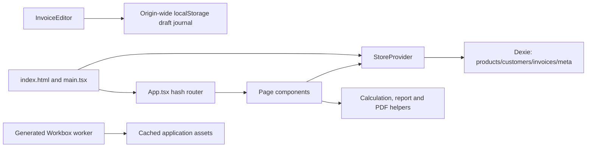
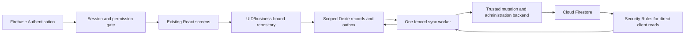

# Billora PWA: technical architecture audit before Firebase integration

**Audit date:** 8 November 2026 (Asia/Kolkata)  
**Repository:** `musthafamohamed/billora-pwa`  
**Audited commit:** `2dae86a9cc1e0db5a8f192da8b34319523df8cb3`  
**Mode:** analysis only. This report is the only requested repository addition. No application source, dependencies, configuration, schema, or business data were changed.

## 1. Executive summary

Billora is currently a functioning **single-business, browser-local invoicing PWA**, branded “Simple Bill” inside the application. It is not an existing SaaS application with an unfinished login screen. There is no Firebase dependency, authentication, user table, tenant identifier, backend, permission system, synchronization engine, or server-authoritative invoice number allocator. The existing React screens, calculations, invoice snapshots, PDF/report generators, and offline storage can be retained. The persistence and session boundaries need deliberate refactoring before adding cloud access. Evidence: `package.json`, `src/main.tsx:8`, `src/App.tsx:16`, `src/lib/db.ts:13`, `src/lib/store.tsx:49`, `src/lib/types.ts`.

**Recommended architecture:** retain React/TypeScript and Dexie as the local working store; introduce an authenticated, business-bound repository, an atomic local outbox, Firebase Authentication, permission-filtered Firestore reads, and a trusted backend for validated/idempotent mutations, finalization, staff provisioning, and platform administration. Do not run independent Dexie and Firestore persistent write queues for the same records.

The most important findings are:

| Priority | Finding | Consequence |
|---|---|---|
| Release blocker | All four existing tables and the draft journal are unscoped; every page receives the full business dataset. | Adding login or hiding navigation does not establish tenant isolation. |
| Release blocker | Human invoice numbers are calculated from an in-memory snapshot, without a unique index or atomic reservation. | Concurrent tabs/devices can issue the same number. Deleting the highest-numbered record permits reuse. |
| Release blocker | Secure staff creation needs a trusted backend and an atomic slot reservation. | A client-side count or ordinary Firebase signup cannot enforce two active staff securely. |
| Release blocker | GitHub Pages explicitly excludes commercial SaaS hosting. | The proposed production SaaS cannot retain GitHub Pages as its hosting service. See section 15. |
| High | Backup validation is shallow; restore clears all business tables before inserting the supplied records. | Cloud migration must not reuse restore as an automatic upload/import mechanism. |
| High | Local finalized-invoice protection checks status transitions, not complete financial immutability. | The backend must validate cancellation and finalization independently. |
| High | Offline devices cannot learn about suspension or permission revocation immediately. | Define a limited offline-use policy and reject unauthorized queued writes on reconnection. |
| High | Existing logos and line arrays are unbounded and embedded in invoice snapshots. | Some local invoices could exceed Firestore’s document-size limit. Preflight is required. |

**Verification:** TypeScript passed; all **115 tests across 14 files passed**; production compilation and service-worker generation passed with output directed to `/tmp`, preserving the repository’s existing build artifacts. No Firebase project, live business database, DNS configuration, or production deployment was accessed.

## 2. Verified project overview

### 2.1 Scope and evidence standard

The audit inventories all 73 tracked files: 52 under `src`, the dependency manifests, entry/configuration files, deployment workflow, public assets, icon-generation script, README, and earlier deployment/redesign documents. Dependency versions below are resolved from `package-lock.json`, rather than inferred from semver ranges. Generated output was inspected separately. Installed/vendor source is not represented as an independently audited dependency security review.

Labels used throughout:

- **Verified:** supported by repository code, a command result, or a cited primary source.
- **Recommendation:** a proposed future design; it is not implemented.
- **Unverified:** requires access to a deployed environment, Firebase console, actual customer data, or a product decision.

Earlier Markdown reports are historical context, not implementation authority. In particular, old documents saying there is no Git repository, no deployment pipeline, only 65 tests, or a permanently sticky editor total are stale. Current code and the audited commit take precedence. `src/lib/version.ts:9` still displays version `1.8.1` / build `2026-10-28`; `package.json` says `1.0.0`. Those stamps do not identify the current deployed Git commit.

### 2.2 Exact dependency versions

| Package | Declared range | Locked version | Responsibility |
|---|---|---|---|
| `react` | `^19.3.1` | `19.3.1` | Component/state model |
| `react-dom` | `^19.3.1` | `19.3.1` | Browser rendering |
| `dexie` | `^4.4.7` | `4.4.7` | IndexedDB wrapper |
| `jspdf` | `^4.2.1` | `4.2.1` | Invoice/report PDFs |
| `xlsx` | `^0.18.5` | `0.18.5` | Spreadsheet exports |
| `vite-plugin-pwa` | `^2.0.0` | `2.0.0` | Manifest and Workbox generation |
| `workbox-window` | `^7.4.1` | `7.4.1` | Service-worker registration support |
| `typescript` | `^7.0.2` | `7.0.2` | Static type checking |
| `vite` | `^8.3.5` | `8.3.5` | Development/build tooling |
| `@vitejs/plugin-react` | `^6.1.2` | `6.1.2` | React build integration |
| `tailwindcss` | `^3.4.17` | `3.4.17` | Utility CSS |
| `postcss` | `^8.5.32` | `8.5.32` | CSS processing |
| `autoprefixer` | `^10.6.2` | `10.6.2` | CSS compatibility |
| `vitest` | `^5.0.5` | `5.0.5` | Automated tests |
| `jsdom` | `^30.1.3` | `30.1.3` | Test DOM |
| `@types/react` | `^19.3.0` | `19.3.0` | React types |
| `@types/react-dom` | `^19.3.0` | `19.3.0` | DOM renderer types |

The audit host uses Node `24.22.0`; GitHub Actions explicitly selects Node `22`. Production browser versions and the exact Node 22 patch used by GitHub are unverified. No Firebase, Firebase Admin, Firebase Functions, Redux, React Router, or Dexie Cloud package is currently installed as a direct project dependency. Evidence: `package.json`, `package-lock.json`, `.github/workflows/deploy.yml:23`.

### 2.3 Architecture and entry points



- `index.html` loads `src/main.tsx`, applies the saved theme before paint, and supplies root-domain icons and mobile viewport settings.
- `src/main.tsx` registers the service worker and renders `App` within `React.StrictMode` and one `StoreProvider`.
- `src/App.tsx` implements a small hash router: `#/`, `#/invoices`, `#/invoices/{id}`, `#/invoices-new`, `#/invoices-new/{id}`, `#/customers`, `#/products`, `#/reports`, `#/settings`, and `#/welcome`.
- `StoreProvider` owns loaded arrays, the profile, theme, welcome state, and async CRUD functions. Mutations usually write IndexedDB and then reload the complete arrays. There is no repository abstraction, `liveQuery`, cross-tab state subscription, pagination, or session boundary.
- Pages maintain editor/forms/filter state locally. `components/ui.tsx` provides fields, sheets, confirmations, badges, buttons, money formatting, and installation help; `Icon.tsx` provides inline SVGs. `BottomNav.tsx` has six unconditional feature entries.
- `src/index.css`, `tailwind.config.js`, and `postcss.config.js` own presentation. `printStyles.ts` keeps PDF output independent of the screen theme.

Existing module structure (no proposed Firebase files are included here):

```text
index.html
package.json / package-lock.json
vite.config.ts / vitest.config.ts / tsconfig.json
tailwind.config.js / postcss.config.js / .gitignore
.github/workflows/deploy.yml
public/CNAME
public/icons/{icon-192.png,icon-512.png,maskable-512.png}
scripts/make-icons.py
src/
  main.tsx / App.tsx / index.css / vite-env.d.ts
  components/ BottomNav.tsx / Icon.tsx / InstallSection.tsx / ui.tsx
  pages/ Dashboard.tsx / Invoices.tsx / InvoiceEditor.tsx / InvoiceDetail.tsx
         Customers.tsx / Products.tsx / Reports.tsx / Settings.tsx / Welcome.tsx
         four component test files listed in section 14
  lib/ backup.ts / backupStatus.ts / calc.ts / db.ts / format.ts
       invoiceNumber.ts / invoiceRecovery.ts / invoiceSaving.ts / lastTaxSplit.ts
       pdf.ts / printPdf.ts / printStyles.ts / reportExport.ts / reports.ts
       starter.ts / store.tsx / systemNote.ts / types.ts / useInstall.ts
       version.ts / words.ts
       ten unit test files listed in section 14
README.md / DEPLOYMENT_PLAN.md
REDESIGN_AUDIT.md / REDESIGN_BASELINE.md / REDESIGN_PLAN.md / REDESIGN_FINAL_REPORT.md
```

### 2.4 Current identity and business configuration

There are **no users or roles**. Anybody with access to this browser profile can use its stored records. First-run Welcome is onboarding, not authentication. One `BusinessProfile` is serialized in `meta/profile`; it has contact/address/GST/prefix/default-rate/logo/bank/UPI/terms fields, but no business ID, owner UID, revision, or timestamps. Welcome is prefilled with PM Sons data from `starter.ts`; the starter catalogue is company-specific, not a generic tenant template. New tenant creation must not silently seed this company’s profile/catalogue. Evidence: `src/pages/Welcome.tsx`, `src/lib/starter.ts:30`, `src/lib/types.ts:9`, `src/lib/db.ts:27`.

### 2.5 Commands and deployment

| Command | Current action |
|---|---|
| `npm run dev` | Vite development server; development service worker enabled |
| `npm run typecheck` | `tsc --noEmit` |
| `npm test` | `vitest run` using jsdom |
| `npm run build` | Typecheck, then Vite production build/PWA generation |
| `npm run preview` | Serve built assets locally |

`.github/workflows/deploy.yml` runs on `main` pushes or manual dispatch, executes `npm ci` and the build, uploads `dist`, and deploys with official GitHub Pages actions. It **does not run `npm test`**. Deployment uses GitHub OIDC permissions; those permissions are unrelated to application users. `public/CNAME` contains `invitedigital.online`; Vite base, manifest scope, and start URL are `/`. Hash routing avoids ordinary static-host path-rewrite requirements. Actual DNS, HTTPS configuration, and the latest successful hosted Actions run are **unverified**. Evidence: `DEPLOYMENT_PLAN.md`, `.github/workflows/deploy.yml`, `vite.config.ts`, `public/CNAME`.

## 3. Complete existing feature inventory

All rows describe implemented behavior unless explicitly marked absent. Dexie access normally happens through `store.tsx`, even where a page only consumes arrays.

| Module and main files | Functionality and data/CRUD | Tables and relationships | Integration concern |
|---|---|---|---|
| Dashboard — `pages/Dashboard.tsx` | Monthly FINAL total/count; five recent invoices; setup/install actions; “Outstanding” sums FINAL invoices with any due date. Read-only. | `invoices`, `meta/profile`; calculations use issue date, status and grand total. | “Outstanding” is not unpaid balance or overdue debt; no payment data exists. Scope queries and summaries to the authenticated business/permissions. |
| Invoice list — `pages/Invoices.tsx` | Search number/customer snapshot; TAX/NON_TAX and DRAFT/FINAL/CANCELLED filters; newest created first; opens detail/editor. Read-only. | `invoices`; reads embedded customer snapshot. | Entire collection currently loaded; future data scopes and pagination must preserve report/list ordering. |
| Invoice editing — `pages/InvoiceEditor.tsx` | Creates/updates DRAFT; selects/adds customer; selects active product or creates one-off item; dates, quantities, rates, discounts, tax split, notes, terms, charge label/amount; Save Draft and Finalize. | `invoices`, `customers`, `products`, `meta/profile`; embeds snapshots and line items. | Current number allocation/client totals are not cloud authority; pending local work needs an outbox, scoped journal, and explicit server acknowledgement. |
| Invoice items — `lib/types.ts:55`, `lib/calc.ts`, editor | Embedded line IDs, optional product/HSN, name/description/unit, quantity, unit price, discount mode/value, rate, computed subtotal/discount/taxable/tax/total. Add/edit/remove inside a draft. | No line-item table; `invoices.lineItems[]`. Custom lines have empty product references. | Keep invoice and lines one aggregate while within size bounds; preserve custom lines. Do not require every line to reference a product. |
| Invoice detail — `pages/InvoiceDetail.tsx` | Snapshot preview; download/share/print PDF; duplicate into a new draft; cancel FINAL with confirmation. No ordinary invoice hard-delete control. | `invoices`; duplication creates invoice/line IDs. | Duplication retains the original issue/due dates and initially appends `-COPY`; server must allocate a new official number. Cancellation must not permit other financial edits. |
| Customers — `pages/Customers.tsx` | Create/read/update; name/phone search; optional phone/email/address/GSTIN/state/notes; duplicate-phone warning with override; customer invoice history. No customer delete API or UI. | `customers`; `Invoice.customerId` and `customerSnapshot.id`; history uses customer ID. | Phone is neither unique nor an identity key. Permission-scoped customer access; deleted legacy references need explicit migration treatment. |
| Products — `pages/Products.tsx`, `lib/starter.ts` | Create/read/update; activate/deactivate; at most seven active in UI; new products at cap saved inactive; delete only when the current invoice array does not reference them; seeded bricks/tile gums. | `products`; invoice lines reference IDs and hold snapshots. | Guards are not atomic store/backend checks. Concurrent writers can exceed seven; stale UI can delete a referenced record. Company-specific starter healing is unsafe across tenant data. |
| Categories | **Absent:** no type, table, screen, or placeholder implementation. | None. | Do not add a category subsystem merely to integrate Firebase. |
| Units — product form/editor | Product select lists Piece, Kg, Box, Service, Litre, Pack, Hour; custom items accept a string. Seeds use NOS. | String fields in products and embedded lines; no units table. | Preserve existing free-text values. NOS is not in the edit select’s option list, creating a current edit-consistency risk. Do not migrate units into a closed enum without compatibility handling. |
| Reports — `pages/Reports.tsx`, `lib/reports.ts` | Inclusive date/type/status filters; summary, item-wise, HSN-wise; net counts/totals; CSV/XLSX/PDF export/share and Print PDF. Read-only. | `invoices`, plus product lookup for legacy missing HSN. | ALL status includes draft/cancelled money. Legacy HSN enrichment depends on current products; not every report is purely snapshot-stable. Export authorization must match readable data. |
| Payments | **No payment records or workflow.** Bank/UPI details print on invoices. No paid/partial/overdue status, receipts, payment allocation, or online collection. | Fields in profile/business snapshots only. | Do not interpret FINAL as paid or add payment-accounting functionality to this integration. |
| Business settings — `pages/Settings.tsx` | One editable profile, invoice defaults, payment display details, terms, optional uploaded data-URL logo; expandable groups; pending-save protections. | `meta/profile`; copied into future invoices. | Profile updates must be owner-authorized and versioned. Logo size/type needs limits before cloud upload. Historical snapshots must not follow live profile edits. |
| Tax — `lib/calc.ts`, `lib/types.ts`, editor | Per-line GST, CGST+SGST/IGST/combined GST; AUTO state matching and explicit split override; additional charges after tax/discount; INR rounding. | Fields in products/profile/invoices. | Reuse arithmetic but validate inputs and recompute final totals on the trusted backend. GSTIN check is syntactic, not government verification. |
| Documents — `lib/pdf.ts`, `reportExport.ts`, `printPdf.ts`, `printStyles.ts` | A4 portrait invoices; landscape reports; wrapping/page breaks, status/logo/HSN/tax details, totals, terms/payment information; native viewer printing; share cancellation/fallback. | Reads invoice snapshots and derived report rows; no PDF table/upload. | Keep pure generation. Prevent access to unauthorized records before generation; stored/exported files cannot be revoked remotely. |
| Backup/restore — `lib/backup.ts`, `backupStatus.ts`, Settings | Plain JSON v1 export; shallow validation; confirmation then transactional replace; clears recovery afterward; records export-request time and weekly reminder. | All business tables and profile; no full `meta`/journal export. | Owner-only migration/import workflow needed. A download request is not proof of a verified backup; local restore is not a safe cloud restore. |
| Appearance — `index.html`, `lib/store.tsx`, `lastTaxSplit.ts`, CSS | Light/dark device preference; remembered tax-split choice; pre-paint theme application. | `meta/theme` and origin-wide localStorage keys. | Separate device preferences from tenant defaults; key user/tenant-specific preferences correctly. |
| Navigation — `App.tsx`, `components/BottomNav.tsx` | Hash routes, first-run redirect, editor keyed by route ID, mobile bottom/desktop side navigation; compact creation shortcut on selected screens. | No routing table in Dexie. | Add auth/permission gates at route and repository boundaries; navigation visibility alone is not authorization. |
| Offline/install — `main.tsx`, `vite.config.ts`, `useInstall.ts`, `InstallSection.tsx`, shared install card | Asset precache; local IndexedDB workflows; install prompt/manual help, secure-context diagnostics; no automatic cloud sync. | IndexedDB + Cache Storage + localStorage are separate stores. | First authentication/bootstrap requires internet; offline authorization needs an explicit policy and scoped caches. |

Supporting pure modules are `format.ts` (INR/date formatting), `words.ts` (Indian amount wording), `systemNote.ts` (hide catalogue-only instructions in invoices), and `invoiceNumber.ts`. `scripts/make-icons.py` generates static PNG assets using Pillow and is not a runtime service. Subscription billing, stock control, categories, expenses, employee management, and email delivery are absent, consistent with the non-goals at `README.md:344`.

## 4. Complete Dexie database analysis

### 4.1 Database and schema inventory

Database name: **`simple-bill-db`**. Application-declared schema: **Dexie version 1 only**. No `upgrade()` callback or earlier version declaration exists. Git history contains the schema in the initial commit; it is unchanged through the audited commit. This does not establish which unpublished schemas might exist on real user devices. Evidence: `src/lib/db.ts:6`, Git history/diff for that file.

| Table | Primary key | Secondary indexes exactly as declared | Value model |
|---|---|---|---|
| `products` | `id` string, supplied by application | `isActive`, `createdAt` | `Product` |
| `customers` | `id` string, supplied by application | `phone`, `createdAt` | `Customer` |
| `invoices` | `id` string, supplied by application | `invoiceNumber`, `status`, `invoiceType`, `issueDate`, `customerId`, `createdAt` | `Invoice` including embedded snapshots/lines |
| `meta` | `key` string | None | `{key: string, value: string}` |

There are no `++` auto-increment keys, `&` unique secondary indexes, compound keys, foreign-key constraints, cascade deletes, tenant indexes, revision indexes, tombstones, operation receipts, or outbox tables. IndexedDB indexes are not field-validation schemas. `isActive` is a boolean in the model, which is not a valid IndexedDB index-key type; current code filters active products in JavaScript instead of relying on that index. A future schema must not assume `.where('isActive').equals(true)` works. [Dexie indexable-key documentation](https://dexie.org/docs/Indexable-Type).

### 4.2 Record fields and identity

- **Product:** ID; name/description/unit; sellingPrice/defaultTaxRate/hsnSacCode; isActive; createdAt/updatedAt.
- **Customer:** ID; name/phone/email/billingAddress/gstin/state/notes; createdAt/updatedAt.
- **Invoice:** ID/number/type/status; issueDate/dueDate; customerId; customerSnapshot/businessSnapshot; embedded lineItems; subtotal/discountAmount/taxableAmount/taxBreakdown/totalTax/grandTotal; optional additional charge label/amount and taxSplit; notes/terms; createdAt/updatedAt.
- **Profile:** business/contact/tax/default/logo/payment-display fields, without an ID or timestamp. Stored as JSON under `meta/profile`.
- **Other meta keys observed:** `theme`, `welcomed`, `starterSeeded`.

`uid()` uses a base-36 timestamp plus `Math.random()` substring. These are strings, **not UUIDs**, cryptographic identifiers, server IDs, or guaranteed globally unique keys. Starter product IDs are deterministic `starter-...` values and will repeat on different installations. Line IDs use the same local generator. Existing IDs should be preserved during normal adoption; new records should use cryptographically random UUIDs/Firestore-generated IDs without changing already-issued invoice identifiers. Evidence: `src/lib/types.ts:163`, `src/lib/starter.ts:66`.

Product/customer/invoice timestamps are client-generated ISO strings. There is no trusted server timestamp, revision, actor UID, device ID, deletion time, or synchronization acknowledgement. Profile/meta have no generic timestamp. Client timestamps alone cannot safely resolve multi-device conflicts.

### 4.3 Relationships

`Invoice.customerId -> Customer.id`; `customerSnapshot.id` normally repeats that reference. `Invoice.lineItems[].productId -> Product.id` is optional/empty for custom items. Business/customer/item snapshots intentionally preserve document content after later catalogue/profile edits. Invoice history uses customer ID, not names or phone numbers. No database constraint enforces any relationship. Historical invoices must remain readable even if a source reference becomes unavailable. Evidence: `types.ts:55`, `types.ts:84`, `types.ts:94`, `types.ts:111`, `Customers.tsx:69`, `InvoiceEditor.tsx:89`.

### 4.4 Readers, writers, transactions, and deletion

`store.tsx:60` reloads products/customers sorted by `createdAt` and invoices by `issueDate`. Each normal CRUD call writes then reloads all arrays. The invoice write path uses a read/check/put transaction so an already-final/cancelled invoice cannot be downgraded by a stale draft. `InvoiceSaveQueue` orders one editor’s async writes; neither mechanism is a cross-device synchronization protocol.

`replaceAll` uses a single transaction across products/customers/invoices/meta: clears the three business tables, bulk-inserts supplied arrays, and replaces/removes the profile. Other meta keys remain. This provides local transaction atomicity, not tenant isolation or remote rollback. `reload()` afterward can additionally seed or delete starter-named duplicates outside the restore transaction. Evidence: `store.tsx:138`, `store.tsx:149`, `invoiceSaving.ts:5`.

Deletion paths:

1. Product UI deletes only unreferenced products after confirmation; store `deleteProduct` itself is unconditional.
2. Store `deleteInvoice` hard-deletes by ID, without status/reference/number-retention checks; no ordinary page calls it.
3. No customer delete method/control exists.
4. `reload()` automatically bulk-deletes all but the first product sharing a starter name. It does not remap invoice references or compare product contents.
5. Backup restore clears all three business tables.
6. Recovery helpers remove malformed/superseded local journals; Settings clears them after successful restore.

Automatic starter healing can remove legitimate changed products or leave line product references orphaned. Existing snapshot data may keep the historical invoice readable, but that does not repair the reference. Do not carry this name-based deletion into a tenant repository. Evidence: `store.tsx:72-87`, `Products.tsx:35`, `Products.tsx:131`, `invoiceRecovery.ts:43`.

### 4.5 Validation and numbering findings

UI validation checks required names, optional GSTIN format, some numerical ranges, and invoice completeness. Finalize also requires an invoice date. Local autosave intentionally retains unfinished input. The store does not generally revalidate customer/product payloads, enforce the seven-active-product cap, or verify invoice arithmetic/unique numbers/references. The local cancellation guard permits FINAL -> CANCELLED but does not compare financial fields. These are acceptable observations about a trusted local operator app, **not sufficient cloud trust boundaries**. Evidence: `calc.ts:110`, `calc.ts:143`, `InvoiceEditor.tsx:202`, `invoiceSaving.ts:33`, `store.tsx:135`.

`nextInvoiceNumber()` sanitizes prefix and returns the maximum matching current prefix/year suffix plus one. There is no sequence table or uniqueness reservation. Two calls using the same snapshot both return the same number. Removing the record holding the maximum number permits it to be generated again. The comment claiming numbers are never reused after deletion is stronger than the implementation. Drafts receive numbers before finalization. Evidence: `invoiceNumber.ts:5`, `InvoiceEditor.tsx:39`, `db.ts:19`.

### 4.6 Backup format and failure exposure

The envelope is `{app:'simple-bill', version:1, exportedAt, profile, products, customers, invoices}`. Optional charge/tax-split fields support older backups by caller defaults. Backup v1 is distinct from Dexie version 1 and the displayed application version.

Validation checks only selected outer fields. It does not fully check profile fields, line-item shapes, finite money values, dates, timestamps, duplicate IDs, duplicated invoice numbers, references, or snapshot/total consistency. Duplicate IDs are accepted; bulk `put` can replace an earlier same-key entry with a later one. Missing indexed timestamps/dates may make imported records absent from index-based UI reads. The “strict validation” comment is therefore misleading. Restore also has no dry-run reconciliation against a cloud tenant. Evidence: `backup.ts:28-64`, `Settings.tsx:90-103`, `store.tsx:149`.

Exports omit unsaved recovery journals, most metadata, theme/tax-split preferences, and any future identity/outbox information. They are unencrypted files containing private business/customer data. There is no verified on-disk backup acknowledgement or backup rotation service. The weekly reminder records only an export request (`backupStatus.ts:13`).

### 4.7 Read-only reproduction evidence

Temporary probes imported the actual pure helpers; they did not open or mutate an application database:

| Probe | Observed result |
|---|---|
| Two number allocations from `['INV-2026-0001']` | Both returned `INV-2026-0002` |
| Allocate after highest `0002` is removed | Returned `INV-2026-0002` again |
| Validate backup with duplicate product IDs, incomplete product/profile fields and invalid export date | Returned no errors |
| Validate FINAL -> CANCELLED with changed grand total | Local status guard accepted the transition |
| Export customer text `=1+1` as CSV | Formula-leading text remained unchanged |
| Derive legacy missing-HSN report using catalogue code 6810, then 3824 | Historical report code changed from 6810 to 3824 |

These observations are regression/architecture inputs, not fixes performed by this audit.

## 5. Existing offline architecture and PWA behavior

| Question | Verified behavior |
|---|---|
| Can an initialized app create invoices offline? | Yes: calculations, customers/products, local writes, and document generation have no cloud API dependency. A browser must previously have loaded/cached the application. |
| Where are records persisted? | Dexie/IndexedDB. Raw unfinished editor inputs also use localStorage, with a memory fallback if persistence fails. |
| How does autosave work? | Synchronous recovery journal on edits; approximately 900 ms debounced invoice write once customer/items exist; ordered manual Save/Finalize; visible status/retry and lifecycle guards. |
| Is there background upload? | No. No outbox, sync endpoint, remote listener, connectivity reconciliation, or service-worker data synchronization exists. |
| What requires internet? | Initial app download, receiving updates, and operations outside the app such as actually sending a shared document. Native install/share also depend on browser support and a secure context. Local PDF/CSV/XLSX creation does not require internet. |
| How is installation handled? | `beforeinstallprompt`, standalone detection, manifest/SW diagnostics, and manual Android/iOS instructions. An install prompt cannot be forced. |
| How do updates happen? | `registerType:'autoUpdate'`; generated worker uses `skipWaiting`, `clientsClaim`, precache and obsolete-cache cleanup. Registration is immediate, with no custom update-confirmation UI. |
| Do app updates erase data? | Same-origin asset/SW updates do not themselves clear IndexedDB/localStorage; current schema remains v1. That is not a guarantee that future application/migration code cannot lose data. |
| What if browser storage is cleared/device lost? | Local records, recovery and preferences are lost unless an external JSON backup exists. There is no cloud recovery today. |
| What about a second device? | Separate browser-origin storage; no shared data or account. It starts its own local database/starter state. Installing a PWA does not copy another device’s records. |

Sources: `src/main.tsx:8`, `vite.config.ts`, `useInstall.ts`, `InvoiceEditor.tsx:125-159`, `invoiceRecovery.ts`, `Settings.tsx:98`.

**Worker-routing detail:** configuration includes both a navigation fallback and a NetworkFirst navigation rule. The actual generated worker registers the catch-all navigation fallback first, then NetworkFirst. Workbox uses the first matching route, so the fallback takes precedence for matching navigations; do not describe production as guaranteed network-first just because that option exists. Evidence: generated `sw.js` from the audited build and [Workbox routing](https://developer.chrome.com/docs/workbox/modules/workbox-routing). This is an offline/update test requirement, not an instruction to rewrite the worker now.

Storage is browser/origin/profile specific; no `navigator.storage.persist()`/quota monitoring or at-rest application encryption is implemented. Same-origin tabs share persistence but their React arrays can be stale. HTTPS/host changes create different origins and can make existing local records appear missing. A hosting move that retains the exact HTTPS custom-domain origin can retain the origin’s local database; a move to a different host requires explicit export/adoption. No actual installed-client behavior was exercised against user data during this audit.

When introducing Firebase, keep auth-handler/API navigations out of the application-shell fallback where applicable. Do not precache tokens, authenticated API responses or private datasets through generic service-worker routes. Test logout and service-worker updates together; an asset cache is not an authorization cache.

## 6. Multi-tenant feasibility and integration boundary

The stack is technically compatible. Keep the UI and pure domain/output helpers. Do not replace Dexie with Firestore reads throughout the screens, and do not create a second independent offline truth by simply enabling Firestore persistent caching.

Recommended ownership:



For the first SaaS release, route **business mutations through the trusted backend**. It can share validation/calculation code, enforce revisions and immutable invoices, atomically acknowledge operation IDs, and allocate final invoice numbers. Direct Firestore client writes should be denied for those collections. The frontend may listen/read allowed business collections under Security Rules. This is more deliberate than client-only CRUD, but avoids implementing incompatible financial validation in UI, Rules, and server independently.

A smaller direct-client-write pilot is possible for tightly constrained drafts/catalogue records with equally tested Rules. It is not the recommended default here: arbitrary invoice-line arithmetic, finalization, provisioning, and import still need trusted validation. Admin SDK writes bypass Security Rules, so the backend’s checks and tests are essential, not optional. [Firebase Rules conditions](https://firebase.google.com/docs/firestore/security/rules-conditions).

Do not introduce Redux, a new router, a component framework, or a new database just to add authentication. A repository boundary can initially retain the existing `useStore` surface while its internals become session-scoped.

## 7. User roles, permissions, and secure provisioning

### 7.1 Recommended access model

Use Firebase Auth UID for people and a separate randomly generated `businessId` for the tenant. App-level business tenancy does not require enabling Identity Platform’s separate authentication-tenant product. Each Owner and Staff user has one business binding initially. SuperAdmin is a platform role, not an implicit member of every business.

| Action | SuperAdmin | Owner | Staff |
|---|---|---|---|
| View/manage registered business status, owner binding, staff cap | Authorized platform metadata only | Read own status/cap | Read own access status |
| Read invoices/customers/products/bank details/reports | No automatic access | Own business | Only allowed datasets/actions |
| Business profile/default settings | Explicit audited support grant only | Manage own business | Only permitted invoice-default projection needed for work |
| Create/edit draft/finalize/cancel | Explicit audited support grant only | Own business | Separate assigned permissions; default draft edits limited to own work |
| Create/reactivate/deactivate staff | Platform administration endpoint when authorized | Own business within cap | Never |
| Change staff cap / grant platform role | Platform backend only | Never | Never |
| Backup export / restore / adopt legacy data | Explicit authorized support workflow only | Own business with safeguards | Denied by default |

Store current role, active state, and permission map in backend-managed membership records. Use coarse custom claims only for platform identity/routing hints, not as the sole current staff-permission or business-suspension authority. Claims propagate on token refresh; membership/status checks must use authoritative current state. [Custom claims](https://firebase.google.com/docs/auth/admin/custom-claims).

Define permissions as explicit actions: `invoices.read/create/updateOwnDraft/finalize/cancel`, `customers.read/write`, `products.read/write`, `reports.read/export`, `settings.manage`, `staff.manage`, `backup.export/import`. UI navigation, route guards, repository queries, mutation endpoints, and Rules must agree. Creating an invoice needs authorized access to customer/product/invoice-default data; derive or validate those dependencies when the Owner saves a staff policy.

An export/print UI restriction cannot prevent a person from copying data already readable on their device. If confidential fields must be hidden, do not download those fields. Firestore document reads return documents, not a field-redacted view; separate safe invoice defaults from private administrative settings where necessary. [Field access design](https://firebase.google.com/docs/firestore/security/rules-fields).

### 7.2 Two active staff, including concurrent requests

Never enforce the cap with “count users, then create” or a client-owned counter. Provisioning/reactivation must be online:

1. Verify the caller’s ID token and current Owner membership/business status; validate requested permissions and an idempotency key.
2. In a Firestore transaction, reserve an available slot under the business’s backend-controlled cap, initially two. Pending reservations count against the cap. Bind the reservation to the operation and a stable proposed Auth UID.
3. Create the Auth account with Admin SDK, initially disabled, or idempotently recover the account created by a retry.
4. Commit the membership and slot assignment, then enable the account and deliver a secure onboarding/password-setup flow. Never store/log plaintext staff passwords.
5. Reconcile partial failures with a resumable provisioning record. Auth account creation and a Firestore transaction are not one cross-service atomic operation; do not free a slot blindly while a created identity/membership may still exist.
6. Deactivation first revokes active membership access, then disables/revokes Auth sessions, and releases the matching slot safely. Reactivation reserves a slot again. Lowering the cap below active/reserved usage requires an explicit policy, not silent eviction.

Three concurrent requests with two slots must result in at most two granted memberships. Retry of the same request must not consume another slot. Admin SDK provisioning avoids signing the Owner out, which can happen when ordinary client signup is used on the active Auth instance. [Admin user management](https://firebase.google.com/docs/auth/admin/manage-users), [Firestore transactions](https://firebase.google.com/docs/firestore/manage-data/transactions).

### 7.3 Platform support access

Platform screens should see account status, cap, owner association and non-sensitive sync-health metrics only. Support access requires a tenant/action/time-limited grant, Owner authorization except a separately approved emergency policy, and an append-only audit trail. No catch-all `isSuperAdmin => read all business documents` Rule is acceptable.

This is application-role isolation, not a claim that infrastructure administrators are cryptographically unable to read a database. Admin SDK/IAM and project-console privileges can bypass application Rules. Restrict operational credentials, separate support execution from ordinary platform UI, and audit privileged operations. Stronger operator-blind confidentiality would require a separate encryption/key-management design and is not present today.

## 8. Recommended Firestore data model

All paths below are **proposed**, not existing repository features. Use Standard edition unless a measured need justifies another edition.

| Path | Purpose and access |
|---|---|
| `users/{uid}` | Minimal user profile and backend-managed business binding; self-readable; self-editable display preferences only where explicitly allowed |
| `platformAdmins/{uid}` | Backend-managed platform administrator registration/status; not a business-data grant |
| `businesses/{businessId}` | Administrative metadata: name, owner UID, active/suspended/deactivated status, `maxActiveStaff`, policy version; no bank/customer/invoice payloads |
| `businesses/{bid}/members/{uid}` | Role, permission map, active/provisioning/deactivated state, membership version; backend-written |
| `businesses/{bid}/staffSlots/{slotId}` | Stable slot/reservation/UID binding, provisioning operation, lifecycle; backend-only writes |
| `businesses/{bid}/settings/profile` | Private business profile/defaults, versioned; Owner/support-authorized reads |
| `businesses/{bid}/settings/invoiceDefaults` | Deliberately approved projection needed to create/print invoices; never assumed non-sensitive |
| `businesses/{bid}/products/{recordKey}` | Versioned product or tombstone; permission-filtered reads |
| `businesses/{bid}/customers/{recordKey}` | Versioned customer or tombstone; permission-filtered reads |
| `businesses/{bid}/invoices/{recordKey}` | Invoice aggregate/snapshots, official status/number, version, authorship; permission-scoped reads |
| `businesses/{bid}/numberSeries/{seriesKey}` | Server-owned prefix/period sequence high-water mark |
| `businesses/{bid}/invoiceNumbers/{numberKey}` | Server-owned uniqueness reservation pointing to an invoice, including legacy reservations |
| `businesses/{bid}/operations/{opId}` | Idempotency receipt with request hash/result revision; sanitized acknowledgement visible only to its actor/authorized Owner |
| `businesses/{bid}/syncCounters/{entity}` | Server-owned monotonic per-module sequence/high-water metadata; readable only when that module is readable |
| `businesses/{bid}/migrationJobs/{jobId}` | Source fingerprint, checkpoints, mapping exceptions, verification and adoption state |
| `businesses/{bid}/auditEvents/{eventId}` | Append-only business operation audit; sensitive payloads excluded by default |
| `supportGrants/{grantId}` and `platformAudit/{eventId}` | Scoped support authorization and platform audit, separate from ordinary tenant datasets |

Keep existing record `id`, `createdAt`, client-compatible ISO `updatedAt`, snapshots and monetary fields. Add `businessId`, `createdByUid`, `updatedByUid`, `revision`, `serverUpdatedAt`, `serverSequence`, `deletedAt`, and format/schema version as appropriate. Device-local sync state belongs in Dexie, not in the canonical business record. Never use a client-supplied UID/tenant field as authority.

Existing safe IDs can remain document keys. Legacy imported IDs are arbitrary strings under today’s validator: preflight Firestore path/length restrictions. If encoding/mapping is necessary, retain the original `id` as data and a durable mapping; remap every affected reference consistently and obtain review for collisions rather than silently overwriting. New entity and operation IDs should be cryptographically random. Do not use human invoice numbers as document IDs.

Use embedded invoice lines/snapshots initially to preserve atomic document behavior. Firestore documents are limited to **1 MiB**; disable unnecessary indexing of large snapshots, line arrays, notes and image strings. Bound new payloads and preflight historical documents. Large legacy invoices need an explicit archive/asset strategy, not truncation. Firebase Storage is a separate billed-plan decision; a base64 logo is not magically moved into it. [Firestore limits](https://firebase.google.com/docs/firestore/quotas).

Initial indexes should serve actual queries: module `serverSequence` ordering and any authorized invoice creator/status/date queries. Define composite indexes in a committed `firestore.indexes.json`; do not assume Rules act as a filter on an otherwise unrestricted collection query. [Secure queries](https://firebase.google.com/docs/firestore/security/rules-query).

## 9. Synchronization architecture

### 9.1 Local-first repository plus transactional outbox

Use both patterns together: the repository owns business invariants and the active UID/business binding; the outbox makes local changes durable and retryable. They are not competing alternatives.

| Approach | Benefit | Why it is insufficient or appropriate here |
|---|---|---|
| Firestore-only with persistent SDK cache | Fewer custom sync components; built-in offline writes | Replaces the requested Dexie working store; ordinary conflict behavior is last-write-wins, not audited invoice conflict handling. |
| Dexie plus ad hoc `setDoc` after each local write | Looks small initially | A crash between the local write and upload loses synchronization intent; duplicate sends, permission failures and tombstones are not handled. |
| Repository + Dexie outbox + explicit online transport | Atomic local changes, retries, version conflicts, scoped imports | Recommended. Requires a real sync protocol and tests; does not require replacing the UI/domain helpers. |
| Dexie Cloud | Managed alternative product | Not installed and not a transparent Firestore adapter. It changes the requested backend choice and should not be introduced implicitly. |

Firestore’s offline cache synchronizes **Firestore SDK writes**, not arbitrary Dexie tables. Its documented conflict model is last-write-wins. Prefer Firestore’s default memory cache for direct online listeners in this design, with Dexie as the durable local cache/outbox. [Firestore offline behavior](https://firebase.google.com/docs/firestore/manage-data/enable-offline).

### 9.2 Local database/session boundary

**Preferred migration:** leave `simple-bill-db` version 1 intact as a legacy source. Create a separate database through a factory, for example `billora-tenant-v1:{firebaseUid}:{businessId}`, opened only after identity/membership initialization. Each principal/business gets an isolated cache, including on shared browsers. This avoids changing current primary keys in place, prevents deterministic starter IDs colliding across tenants, and makes rollback inspectable.

The new tenant database starts with its **own schema version 1**; that does not change the old database’s version or backup v1. Future changes append Dexie versions and tested upgrade functions. Do not label the new schema “legacy Dexie v2” when it is a different database. An alternative same-database migration would need additive tenant tables/compound keys and a separate copy phase; do not replace the current primary key in place. [Dexie versioning](https://dexie.org/docs/Tutorial/Design).

Proposed new-database stores:

| Store | Suggested key/indexes | Ownership |
|---|---|---|
| `products` | `id`; `serverSequence`, `createdAt` | Current principal/business cache; retain `businessId` in each record for validation |
| `customers` | `id`; `phone`, `serverSequence`, `createdAt` | Same boundary |
| `invoices` | `id`; `invoiceNumber`, `status`, `invoiceType`, `issueDate`, `customerId`, `serverSequence`, `createdAt` | Same boundary; official number uniqueness is enforced by server reservations, not this local index |
| `settings` | `key` | Scoped settings/defaults and versions |
| `outbox` | `opId`; `state`, `[entity+recordId]`, `createdAt` | Immutable queued mutation envelope after transmission begins |
| `syncMeta` | `key` | Per-module cursors, permission version, initial-bootstrap checkpoint |
| `workingCopies` | `invoiceId` or explicit new-draft ID | Recoverable incomplete editor inputs; namespaced by database |
| `conflicts` | `conflictId`; `recordId`, `createdAt` | Local input and server revision retained for resolution |
| `migrationMeta` | `jobId` | Local adoption checkpoint and original source fingerprint |

Avoid the boolean-index problem; either filter small product caches or index a normalized string/numeric active-state field if a query needs it. A scope assertion must still reject payloads whose embedded `businessId` differs from the bound repository.

On auth/business change: stop listeners and sync leases, invalidate an asynchronous session-generation token, unmount the old provider, clear in-memory arrays/selected records, close its database handle, then initialize the next scope. Old completions must never update the new session. Pending work remains bound to its original UID/business; do not upload it under the next login. Sign-out/cache retention on shared devices needs the policy in section 18.

A separate database name is an application isolation boundary, **not encryption**: another person controlling the same browser profile can inspect same-origin plaintext storage outside the UI. Default shared/untrusted devices to session-only operation without durable business caches; enable durable offline use only under an approved trusted-device policy. If durable shared-device offline data is required, specify key protection and pending-work recovery before implementation instead of promising secrecy from UI logout alone.

### 9.3 Mutation lifecycle and idempotency contract

1. The repository validates a local intent and writes the record/working state **and outbox entry in one Dexie transaction**. An incomplete editor working copy need not become a canonical invoice yet.
2. An outbox envelope contains `opId`, business/actor binding, entity type, stable record ID, action, expected `baseRevision`, payload/version, device ID, creation time, dependencies and retry state. The backend derives actor identity from the verified token, not these fields.
3. One fenced worker per scope sends operations when online, on foreground/resume, and after debounce. Use Web Locks where available and a transactional Dexie lease/fencing fallback for multi-tab coordination.
4. The backend authorizes current membership/business status and action, validates shape/size/references, and applies a transaction. An operation receipt and resulting record/revision/sequence are committed together.
5. A repeated `opId` with the same request hash returns the prior result. A reused `opId` with a different payload is rejected. Transport delivery is at least once; business effects become effectively once through deduplication.
6. Acknowledgement updates the local confirmed revision and removes/acknowledges the matching outbox entry atomically. A timeout after a server commit is retried with the same ID; it does not create a second invoice.

Coalesce only **unsent** draft updates for the same record. Never mutate the payload of an in-flight/idempotently identified operation. Preserve newer editor changes over an older acknowledgement and rebase dependent unsent operations after the accepted revision. Explicit finalization must wait for required local operations, matching the ordering already protected locally by `invoiceSaving.ts`.

Retry temporary network/quota/unavailable errors with exponential backoff and jitter. Treat permission/suspension, unsupported schema, invalid data and revision conflicts as blocked/conflicted states, not endlessly retried transport errors. Preserve rejected user input for authorized review/export; do not delete it to make the queue look healthy.

### 9.4 Pulls, cursors and authority

Use server-assigned monotonic per-module sequences with bounded, permission-specific queries such as the tenant’s invoice collection ordered by `serverSequence`. Each server mutation updates the applicable sequence counter and record/tombstone atomically. Persist the last completely applied page/cursor in the same local transaction as its records. Query again from that cursor after interruption; duplicates are harmless when matched by ID/revision.

Start with a complete allowed-module bootstrap, then incremental catch-up. Do not advance a cursor past unapplied records or treat a partial/denied query as an empty authoritative dataset. Do not overwrite a pending local edit with a remote record: maintain confirmed state plus local working/pending state. A changed permission version requires recomputing permitted modules and invalidating now-disallowed caches, not merely hiding a tab.

Avoid a tenant-wide change feed containing every record payload: a restricted staff member must not receive finance/customer data through a generic sync log. Module counters should also be permission-scoped. At the initial three-user business size, transactional sequence counters are reasonable; measure contention before using this design at much larger write rates.

### 9.5 Conflict resolution and deletions

- **Products/customers/settings:** apply compare-and-set on a server revision. On mismatch, retain both versions and show a conflict; a confirmed retry supplies the new base revision. Do not use client clock order as authority.
- **Draft invoices:** default to the same optimistic conflict rule. Do not merge line arrays by array position or silently combine monetary edits. A later operation must not undo finalization.
- **Final invoices:** financial snapshots, totals, lines, ID and official number are immutable. Cancellation is a narrow allowed operation with reason/actor/time. Corrected documents are new records linked to the original.
- **Deletes:** use revisioned tombstones, preferably archive/deactivate for referenced entities. A stale update cannot resurrect a tombstone. Never hard-delete final invoices/number reservations as ordinary CRUD.
- **Retention:** retain tombstones until the supported offline window has elapsed and all relevant sync checkpoints are safe, or force full rebootstrap for devices older than the retention boundary. Garbage collection is a trusted maintenance operation; TTL cleanup is not a free Spark assumption.

### 9.6 Offline invoice numbering and finalization

The recommended default is **offline draft creation, online authoritative finalization**:

1. An offline draft gets a stable entity ID and an unmistakable provisional reference, not a claimed globally unique sequential tax-invoice number.
2. A finalize request is queued and visibly marked pending. The local official business status remains DRAFT until server acknowledgement; keep sync/finalization state separate from the existing DRAFT/FINAL/CANCELLED enum.
3. The backend verifies permission and totals, reserves the next series/period number, writes its uniqueness reservation, freezes the invoice, and records the operation result in one transaction.
4. Repeated finalization returns the same official number. Rejected/conflicted finalization preserves the draft and explains the next action.
5. Official PDFs must not present a pending draft as an already-issued FINAL invoice. A draft/provisional print can be available with explicit status.

Client Firestore transactions fail offline, so they are not an offline sequence allocator. [Transaction documentation](https://firebase.google.com/docs/firestore/manage-data/transactions).

If issuing official invoices while disconnected is a hard requirement, choose and approve a different policy before coding: distinct device/branch series, or server-reserved blocks that are never reissued and may leave gaps. Offline, globally sequential, gapless numbering across independently disconnected devices cannot be promised. Preserve every historical final number exactly; migration collisions require explicit resolution, not renumbering old documents in the background. Calendar-year versus financial-year series is a product/accounting decision.

## 10. Safe data ownership and migration strategy

### 10.1 Preconditions and ownership assignment

Existing local records have no authenticated owner. A logged-in account must not automatically claim whatever happens to be stored in that browser. Require explicit Owner confirmation of the destination business, show the source business/profile and counts, and verify a backend-issued adoption authorization for that business. Staff cannot adopt or restore an unrelated local dataset.

Before switching paths, export and retain a legacy JSON backup, plus the original database/working copies. Capture a source fingerprint, counts, ID sets, relationships, per-status invoice counts and monetary summaries. Collect unfinished local working copies separately: the current backup does not include them. Do not open `StoreProvider.reload()` just to inspect data in a migration tool: it can seed or delete starter duplicates.

### 10.2 Dependency-ordered adoption procedure

| Checkpoint | Action | Required proof before advancing |
|---|---|---|
| M0 — source frozen | Pause the old app’s writers/other tabs; obtain backup and inventory directly without healing/seed writes. | Original retained; source fingerprint and ID sets recorded; operator confirms correct browser/origin. |
| M1 — preflight | Deep-validate profile/records/lines, finite money, date/timestamp fields, IDs, duplicate IDs/numbers, references, snapshot consistency and encoded cloud sizes. | Every anomaly is categorized: accepted legacy exception, quarantined record, or blocking error. No silent dropping/defaulting of financial content. |
| M2 — destination authorized | Create/confirm owner/business binding and a resumable migration job. | Backend confirms caller can adopt into this exact business; target is empty or an explicit merge plan is approved. |
| M3 — local copy | Copy accepted data into the new principal/business database, preserving IDs, timestamps, snapshots, statuses and original numbers. | Counts/ID sets/hashes and known totals agree; legacy database remains unchanged. |
| M4 — remote staging | Upload bounded idempotent batches into inaccessible staging for this tenant/job, with source IDs/hashes and exception mappings. | Checkpoints and receipts allow retry after any batch; no other business or ordinary staff can read staging. |
| M5 — verification | Compare complete local/staged manifests, relationships, sample generated PDFs, status counts and per-invoice totals; reserve existing final numbers/high-water marks. | Signed-off verification report; duplicate legacy numbering explicitly resolved or preserved with documented provenance. |
| M6 — activation | Activate the tenant’s adopted dataset/epoch and enable ordinary writes only after verification. | Authorized reads return the complete accepted set; Rules/backend isolation tests pass; staging is not confused with live data. |
| M7 — observation | Keep legacy backup/source for an agreed retention period; monitor conflicts/rejections and verify recovery on a second device. | Owner approves adoption completion; no destructive legacy cleanup is automatic. |

Staging is necessary for large imports because an entire business need not fit a single Firestore transaction. Activation must not temporarily expose a half-imported set. Use a backend-controlled dataset generation/activation pointer or equivalent gating, and prevent normal edits during initial adoption. This is a migration mechanism, not a permanent extra tenancy layer.

### 10.3 Identity preservation, duplicates and orphans

- Do not replace all old IDs with UUIDs just because new records use UUIDs. Preserve valid existing invoice/customer/product/line IDs and all references.
- The same starter IDs across **different** businesses are safe when paths/databases are scoped. The same ID from independent sources being merged into **one** business is a conflict, not proof they are the same record.
- Use source fingerprints plus record ID/content hashes to recognize a retry or cloned backup. Names/phones alone are not reliable deduplication keys. Same ID/different content and same number/different invoice need review.
- Retain final snapshots even if source customers/products are missing. Flag unresolved links; do not invent replacements or discard the invoice.
- Legacy IDs illegal as Firestore keys need an audited reversible key mapping. If remapping an ID is unavoidable, update all linked customer/product references consistently while retaining original provenance.
- Preserve historical money. Report validation differences or current calculation discrepancies instead of recomputing and silently changing previously issued invoices.
- Freeze or explicitly label legacy HSN enrichment during adoption; current `hsnRows` can derive a missing historical code from a mutable product catalogue (`reports.ts:141`).

### 10.4 Rollback and mixed-version safety

Before activation, rollback means disabling/abandoning the staging job and reopening the untouched legacy app/database. Do not delete the source as a rollback “cleanup.” After live SaaS writes begin, rolling back only the frontend is insufficient: first stop new writes, export/reconcile post-cutover server operations, preserve number reservations, then apply a reviewed recovery plan. Never restore an old JSON snapshot over an active cloud business while devices still have queues.

Minimum supported client/schema versions and a server dataset epoch must fence out obsolete writers. A stale installed PWA must not continue authoritatively issuing old local numbers and later overwrite cloud data. Unsupported clients can preserve/export local drafts but cannot bypass new backend invariants. Maintain backwards readers/adapters through an explicit compatibility window; contract/remove old formats only after verified adoption and retention approval.

An already-installed, completely disconnected v1 client has no new server-version check. The backend can reject its future imports/writes, but cannot remotely stop that old standalone code from producing local records. Initial adoption therefore also requires an operational stop on legacy writers and reconciliation of later-discovered offline records; do not describe a server version gate as immediate control over old offline code.

## 11. Security considerations and trust boundaries

### 11.1 Required enforcement

1. **Default deny:** anonymous/unaffiliated Auth users receive no business access. Public Firebase signup must not grant a role or tenant by itself.
2. **Tenant path binding:** Rules and backend validate the path business ID against the current membership and payload binding. Tenant IDs are not authorization secrets.
3. **Current access:** read/write authorization requires active business and active membership, plus the specific action. Owners cannot change their business binding or staff cap via arbitrary profile fields.
4. **Server validation:** backend recomputes final totals with shared domain code, validates finite values/types/limits/references, restricts final/cancel transitions and accepts only known mutation actions/fields. Never accept arbitrary Firestore paths from the client.
5. **No client role edits:** membership, slots, platform role, series, receipts, audit and activation metadata are backend-owned. Permission changes are audited and versioned.
6. **Separate transport security:** CORS/allowed origins and App Check reduce unwanted traffic, but neither replaces ID-token verification and authorization. Rate-limit provisioning/import/finalize endpoints.
7. **Credential hygiene:** Firebase web configuration is public application configuration. Service accounts, Admin SDK credentials, signing keys and backend secrets must never enter `VITE_*`, GitHub Pages artifacts, logs, or the repository.
8. **Audit:** retain actor/business/op/revision/action/result/time with privacy-conscious payload logging. Platform health views should not contain invoice amounts, customer addresses or raw exports.

Recommended Rules contract: permitted clients can read only their authorized business/module documents; all business mutations go through the backend in the recommended architecture. Test Rules and backend authorization separately because Admin SDK bypasses Rules. Queries must satisfy authorization constraints; Rules do not filter forbidden documents out of an all-record query. [Rules/query behavior](https://firebase.google.com/docs/firestore/security/rules-query).

### 11.2 Offline authentication and suspension

Firebase persisted auth state is not offline password verification. First login, account provisioning, password reset, and first permitted-dataset bootstrap require internet. After successful initialization, the app can reopen its already-authorized local cache on a trusted device using persisted identity plus a bounded cached authorization policy. Do not retain plaintext passwords or invent local password verification. Auth persistence is distinct from Firestore data persistence. [Auth persistence](https://firebase.google.com/docs/auth/web/auth-state-persistence).

**Proposed policy requiring approval:** a time-limited offline-use lease, such as 24 hours, refreshed after online verification of current membership/business status. Store the authorized UID/business/permission version and server expiry; signed lease metadata can resist casual tampering but cannot make a user-controlled browser a trusted enforcement environment. A changed local clock or modified JavaScript defeats purely client-side expiry enforcement.

Suspension/revocation must immediately deny new authorized cloud requests through current server checks. Disable/revoke Auth sessions where appropriate; do not rely only on an old custom claim. The disconnected device may retain previously cached readable data until it reconnects or its local policy locks the UI. No PWA can guarantee immediate remote erasure of data or exported files on an offline device. Unauthorized queued operations are quarantined/rejected when connection returns, not reassigned to another user. [Session management](https://firebase.google.com/docs/auth/admin/manage-sessions).

### 11.3 Existing hardening needs

| Finding | Current evidence | Treatment before SaaS |
|---|---|---|
| Origin-wide sensitive recovery/preferences | `invoiceRecovery.ts:12`, `lastTaxSplit.ts:3`; incomplete draft content is plaintext localStorage | Move working copies into scoped databases; close/reset state on account changes; define trusted-device retention. |
| Startup can hide load failure | `store.tsx:57`, `store.tsx:111`, `store.tsx:123` read localStorage without all error guards; reload rejection only sets `loaded=true` | Fail visibly and avoid presenting empty state as a successful load; distinguish unavailable storage from an empty business. |
| Status guard is not full immutable-document validation | `invoiceSaving.ts:33` | Backend cancellation whitelist and immutable financial snapshots; tests for edited totals/lines during cancellation. |
| CSV formula-leading cells are preserved | `reportExport.ts:14`, verified probe | Define spreadsheet-safe string export escaping for untrusted names/notes without corrupting numerical columns; test Excel/LibreOffice behavior. |
| Unbounded image/record size | `Settings.tsx:70`, `types.ts:94`, `pdf.ts` | Validate file types/dimensions/size and cloud payload size; protect uploads/processing and preserve large legacy documents explicitly. |
| Dependency maintenance | `xlsx@0.18.5` in lockfile | Review upgrade/distribution before adding any spreadsheet import. Known prototype-pollution advisory explicitly says export-only workflows are unaffected; no arbitrary spreadsheet import exists here. Do not claim a demonstrated exploit in this app. |
| No deployed-app CSP/security-header configuration in repo | `index.html`, deployment workflow | Add reviewed headers/CSP at the new host without breaking PWA, Firebase/Auth flows, blob viewing or file sharing. |

Advisory references: [SheetJS prototype pollution](https://github.com/advisories/GHSA-4r6h-8v6p-xvw6), [SheetJS ReDoS](https://github.com/advisories/GHSA-5pgg-2g8v-p4x9). This audit did not run a complete live vulnerability scan of every transitive dependency, and no package was installed or upgraded.

## 12. Source-code impact matrix

Risk refers to implementation changes, not an assertion that the file is currently broken. P0 blocks safe tenant/cloud activation; P1 is needed before production; P2 can follow the foundation.

| Existing file/module | Current responsibility | Required change | Risk | Priority |
|---|---|---|---|---|
| `src/main.tsx` | Root render, immediate SW registration, global store | Initialize Firebase/session gate; mount scoped provider only after identity/bootstrap; surface update/migration states | High | P0 |
| `src/App.tsx` | Unguarded hash routes and first-run setup | Add login/no-access/session-expiry routes and permission-aware guards; reset route/editor on identity changes | High | P0 |
| `src/lib/db.ts` | One global Dexie singleton v1 | Retain legacy reader; introduce tenant database factory/schema without destructive old-db upgrade | Critical | P0 |
| `src/lib/store.tsx` | Global arrays, CRUD, seeding/healing, replaceAll | Delegate to bound repository; atomic outbox writes; scoped reads; remove automatic tenant healing; visible load errors | Critical | P0 |
| `src/lib/types.ts` | Local domain types/IDs/snapshots | Add canonical metadata and local sync types separately; preserve legacy decoder and snapshot shapes; new cryptographic IDs | High | P0 |
| `src/lib/invoiceNumber.ts` | Local max-plus-one numbering | Keep legacy parsing for migration; official numbering owned by backend series reservation | Critical | P0 |
| `src/lib/invoiceSaving.ts` | One-editor ordering/status checks | Retain ordering; distinguish local persistence from cloud ack; backend immutable-transition validator | High | P0 |
| `src/lib/invoiceRecovery.ts` | Origin-wide working-copy journal | Session-bound working copies, adoption export, permission/epoch fencing and lifecycle-safe recovery | High | P0 |
| `src/pages/InvoiceEditor.tsx` | Draft inputs, calculations, snapshots, Save/Finalize | Repository-backed saves; pending/conflict states; server finalization; provisional number display; keep existing input/rounding behavior | Critical | P0 |
| `src/pages/InvoiceDetail.tsx` | Document actions, duplicate/cancel | Authorized data; pending versus official document semantics; narrow backend cancellation/correction link | High | P1 |
| `src/pages/Invoices.tsx` | Search/filter local array | Bound/paginated permitted records and sync/conflict badges without silently changing filter meanings | Medium | P1 |
| `src/pages/Customers.tsx` | Customer forms/history | Permission-aware repository operations and revision conflict feedback; preserve optional phone and snapshots | Medium | P1 |
| `src/pages/Products.tsx` | Catalogue/forms/cap/delete guards | Backend/repository cap/reference rules; conflict/archive behavior; preserve existing units | High | P1 |
| `src/pages/Dashboard.tsx` | Local summaries | Scope and distinguish confirmed/pending records; label due-date aggregate accurately unless payment tracking is separately approved | Medium | P1 |
| `src/pages/Reports.tsx` | Reports/exports from loaded arrays | Permission-aware complete dataset/watermark and pending-data disclosure; avoid exporting partial sync as a complete report | High | P1 |
| `src/lib/reports.ts` | Pure projections, totals, legacy HSN fallback | Preserve formulas; make legacy enrichment provenance explicit; accept only authorized/reconciled input sets | Medium | P1 |
| `src/pages/Settings.tsx` | Profile/defaults/backup/restore/demo | Owner controls, staff-management links, scoped settings, safe staged import; prevent cloud-global destructive replacement | Critical | P0 |
| `src/lib/backup.ts` | JSON v1 envelope/shallow validation | Keep v1 reader; add deep validation, versioned tenant/provenance manifest and migration verification; no automatic merge | Critical | P0 |
| `src/lib/backupStatus.ts` | Device-wide export history | Key history by principal/business; distinguish requested export from verified backup/recovery point | Low | P1 |
| `src/pages/Welcome.tsx`, `src/lib/starter.ts` | Single-company onboarding/seeding | Generic SaaS onboarding separate from legacy adoption; no PM Sons seed into unrelated businesses | High | P0 |
| `src/lib/lastTaxSplit.ts` | Origin-wide remembered split | Decide device/user/business scope and namespace accordingly | Low | P1 |
| `src/components/BottomNav.tsx` | Unconditional feature navigation | Permission-aware entries plus dedicated admin/owner areas; not the security boundary | Low | P1 |
| `src/components/ui.tsx` | Reusable forms/sheets/status | Reuse; add specific sync/access feedback as needed and verify focus behavior for auth/admin dialogs | Low | P1 |
| `src/lib/calc.ts` | Arithmetic and validation | Preserve outputs; share pure rules with backend and strengthen wire-input validation around them | High | P0 |
| `src/lib/pdf.ts`, `src/lib/reportExport.ts` | Document and spreadsheet output | Mostly retain; consume confirmed/explicitly provisional authorized data; add export safety/large-record tests | Medium | P1 |
| `src/lib/format.ts`, `words.ts`, `systemNote.ts`, `printPdf.ts`, `printStyles.ts` | Pure formatting/printing helpers | Keep behavior unless a verified compatibility issue requires a narrow change | Low | Retain |
| `src/components/Icon.tsx`, `src/index.css`, Tailwind/PostCSS config, icon assets/script | Presentation/assets | Retain; no Firebase-driven visual rewrite required | Low | Retain |
| `src/lib/version.ts` | Manual stale build stamp | Derive/display a reliable release/commit and supported schema/protocol version | Low | P1 |
| `vite.config.ts`, `src/vite-env.d.ts` | PWA/build configuration | Review API/auth route caching and version/update behavior; retain hash/root compatibility; no credentials in assets | High | P1 |
| `.github/workflows/deploy.yml`, `public/CNAME`, `DEPLOYMENT_PLAN.md` | Pages deployment/custom domain | Replace SaaS hosting target, add tests/emulator gates, least-privilege deployment and same-origin migration plan | High | P0 |
| `package.json`, `package-lock.json`, `vitest.config.ts`, `tsconfig.json` | Dependencies/scripts/tooling | Add only approved SDK/backend/test packages and scripts; separate backend compilation; lock versions | Medium | P1 |
| `README.md`, `REDESIGN_*.md` | User/architecture/history documentation | Update current overview and preserve old reports as historical; document cloud/offline/backup behavior honestly | Low | P1 |

Retain the current tests as a behavior contract. Necessary refactors are persistence/session/validation boundaries, not a wholesale screen rewrite. New modules and their phase ownership follow below.

## 13. Dependency-ordered implementation phases

Nothing in this roadmap was implemented during the audit. Do not install SDKs or connect live business data until the applicable phase is authorized. Keep the audited commit as the behavioral baseline.

### Phase 0 — decide policy and establish release gates

- **Objective:** settle the decisions that determine data correctness and cost before choosing implementation shortcuts.
- **Modifications:** document approved hosting, offline-finalization/number-series policy, device trust/revocation window, data region, staff permission defaults and support access. Plan updates to `DEPLOYMENT_PLAN.md` and `README.md`; retain the existing app unchanged.
- **Expected output:** signed-off architecture decisions, representative legacy backup fixtures with consent, a baseline release tag and a restore rehearsal plan.
- **Acceptance:** no contradictory promise of immediate offline revocation, unlimited free Firebase services, or gapless shared numbering while disconnected. Commercial SaaS hosting is permitted by the selected host.
- **Risks:** selecting an online-finalization policy that does not fit actual offline sales work; moving origins without recovering local data.
- **Tests:** retain the 115-test/typecheck/build baseline; inventory real data sizes and number collisions without modifying it.
- **Rollback:** no data cutover occurred; continue the current release while decisions are unresolved.

### Phase 1 — establish shared validation and the repository seam

- **Objective:** preserve existing behavior while removing the assumption that React context is the only authority.
- **Create:** `shared/billing/types.ts`, `shared/billing/calc.ts`, `shared/billing/validation.ts`; `src/lib/data/repository.ts`, `src/lib/data/codecs.ts`; `src/lib/data/repository.test.ts`, `src/lib/data/codecs.test.ts`.
- **Modify:** `src/lib/types.ts` and `calc.ts` can re-export shared domain definitions to preserve current imports; refactor `store.tsx` to delegate to one concrete repository, initially backed by existing local behavior. Strengthen validation without silently changing monetary rules.
- **Expected output:** a tested boundary for reads/mutations and explicit decoding of legacy optional fields, timestamps and wire values.
- **Acceptance:** existing UI/calculation/export tests still pass; malformed/duplicate backup data is detected by new preflight validation; domain code can run in client and backend without importing DOM/React/Dexie.
- **Risks:** accidental rounding/snapshot changes, circular imports, treating incomplete working copies as valid finalized documents.
- **Tests:** before/after calculation fixtures, legacy charge/taxSplit defaults, malformed finite/type/date/ID cases, reference preservation and cancel-field immutability.
- **Rollback:** revert the delegation/extraction while storage remains in the original format; no remote adoption or destructive schema change yet.

### Phase 2 — Firebase project, authentication and deny-by-default backend foundation

- **Objective:** establish identity and testable authorization before downloading tenant data.
- **Create:** `src/lib/firebase/client.ts`, `src/lib/auth/session.tsx`, `src/lib/auth/permissions.ts`, `src/lib/api.ts`, `src/pages/Login.tsx`; `functions/package.json`, `functions/tsconfig.json`, `functions/src/index.ts`, `functions/src/authorization.ts`; root `firebase.json`, `.firebaserc`, `firestore.rules`, `firestore.indexes.json`, `.env.example`, and separate emulator-test configuration.
- **Modify:** root dependency manifests/scripts, `main.tsx`, `App.tsx`, and `src/vite-env.d.ts`. This is the future phase that introduces packages, not an audit action.
- **Console setup:** create separate development/staging/production Firebase projects; register web apps; select Firestore region deliberately; enable email/password authentication; explicitly authorize intended custom/preview/local domains; deploy deny-by-default Rules; configure emulator routing only in development. Choose Blaze if deploying the recommended Firebase Functions backend. Set IAM, secrets and budget/usage alerts before production.
- **Dependencies:** browser `firebase`; backend `firebase-admin` and, for the recommended hosting option, `firebase-functions`; development `firebase-tools` and `@firebase/rules-unit-testing`. Pin supported versions at implementation time instead of inventing future version numbers in this report.
- **Expected output:** login/logout/session-loading/no-membership flows and a backend that verifies identity but grants no default tenant access.
- **Acceptance:** anonymous and unaffiliated users cannot read business records; no client can grant roles or upload service-account credentials; sign-in failure is visible; logout resets memory/session generations.
- **Risks:** accidental test/prod project mixing, stale claims, exposing data before initialization, provider/domain misconfiguration.
- **Tests:** emulator identity/Rules tests, direct API negative tests, session transitions and rejected cross-business paths.
- **Rollback:** disable the new entry path and revert to local-only mode before any adopted cloud dataset becomes authoritative. Never roll back to permissive test Rules.

### Phase 3 — scoped Dexie databases and verified local adoption

- **Objective:** eliminate origin-wide data mixing before background sync exists.
- **Create:** `src/lib/data/tenantDb.ts`, `src/lib/migration/legacy.ts`, `src/lib/migration/adopt.ts`, `src/pages/AdoptLocalData.tsx`, `src/lib/data/tenantDb.test.ts`, `src/lib/migration/legacy.test.ts`.
- **Modify:** `db.ts`, `store.tsx`, `invoiceRecovery.ts`, `backup.ts`, `backupStatus.ts`, `lastTaxSplit.ts`, Welcome/Settings and the root session gate. Preserve the old database as an explicit read-only migration source; disable legacy seeding/healing in the adoption reader.
- **Dependency:** `fake-indexeddb` for isolated database tests; use real browser IndexedDB in later end-to-end tests as well.
- **Expected output:** separate UID/business databases, scoped incomplete working copies, owner-confirmed local migration manifests and quarantine for anomalies.
- **Acceptance:** switching users never shows another user’s arrays/journal; original IDs/references/snapshots survive copy; original database and backup remain intact; interrupted copy resumes without duplicate records.
- **Risks:** stale asynchronous work crossing session boundaries; losing orphan snapshots; a different host origin hiding the source database.
- **Tests:** upgrade/open behavior, same ID in two tenants, shared-browser logout/login, source-with-missing-fields, duplicate IDs/numbers, denied storage, interrupted copy and rollback.
- **Rollback:** close the new database and reopen the unchanged legacy database; do not delete either during the retention period.

### Phase 4 — platform/owner administration and staff limits

- **Objective:** make account provisioning, tenant status and permission administration authoritative.
- **Create:** `functions/src/platform.ts`, `functions/src/staff.ts`, `functions/src/support.ts`, `functions/src/audit.ts`; `src/pages/PlatformAdmin.tsx`, `src/pages/Staff.tsx`; corresponding backend and Rules tests.
- **Modify:** `permissions.ts`, `session.tsx`, `App.tsx`, `BottomNav.tsx`, Settings and Rules/indexes.
- **Expected output:** business/owner provisioning; business activate/suspend/deactivate; backend-only configurable cap; resumable staff invitations, permissions, deactivate/reactivate; bounded audited support grants. Keep SaaS subscription billing out of this phase unless separately requested.
- **Acceptance:** three parallel provision/reactivate requests cannot grant more than two active/reserved staff under the initial cap; retry consumes one slot; Staff cannot elevate themselves; Owner cannot modify cap/platform role; SuperAdmin cannot read confidential business collections by default.
- **Risks:** Auth/Firestore partial failure, unsafe reservation cleanup, leaked onboarding links, stale active membership after deactivation.
- **Tests:** concurrent requests, injected failure at every provisioning checkpoint, retry/reconciliation, cap reduction policy, owner reassignment attacks, support grant expiry/audit and account suspension.
- **Rollback:** disable provisioning endpoints and preserve reservations/audit records; reconcile identities before release/retry. Do not automatically delete uncertain accounts to free slots.

### Phase 5 — ordinary data synchronization, conflicts and tombstones

- **Objective:** synchronize permitted catalogue/customer/draft data with durable and inspectable outcomes.
- **Create:** `src/lib/sync/outbox.ts`, `src/lib/sync/engine.ts`, `src/lib/sync/pull.ts`, `src/lib/sync/conflicts.ts`, `src/pages/SyncStatus.tsx`; `functions/src/mutations.ts`; sync/database/backend tests.
- **Modify:** repository, tenant DB schema, store adapter, Customers/Products/InvoiceEditor/Invoices, Rules and indexes. A new tenant-schema version is required if these stores were not included at its initial creation; keep previous declarations and tested additive upgrades.
- **Expected output:** atomic record/outbox writes, fenced sending, idempotent receipts, module-specific cursors, conflict preservation, blocked-operation feedback, archived/tombstoned deletes and permission-aware pulls.
- **Acceptance:** crash after local commit, crash after server commit, duplicate send, reconnect and tab races do not lose or duplicate business effects; forbidden modules are never cached; no stale update resurrects a tombstone; server permissions are rechecked for every mutation.
- **Risks:** outbox/record divergence, double-persistence queues, cursor skips, excessive cloud reads/writes, treating offline/denied as an authoritative empty collection.
- **Tests:** deterministic fault injection for each lifecycle state, sequence paging under concurrent updates, two-device conflicts, permission changes, schema mismatch and tombstone retention boundaries.
- **Rollback:** stop transport workers and retain local/outbox data; allow safe local draft preservation. Do not clear the queue or switch its business binding to work around an error.

### Phase 6 — authoritative finalization, numbering and staged cloud migration

- **Objective:** make issued documents and adopted legacy history correct across devices.
- **Create:** `functions/src/finalizeInvoice.ts`, `functions/src/migration.ts`; finalization/numbering/import integration tests.
- **Modify:** editor/detail/list/report screens, repository, backup/adoption orchestration, server validators and Rules. Add provisional/pending display without breaking existing status/snapshot rendering.
- **Expected output:** atomic official number reservation and immutable financial snapshots; narrow cancellation; idempotent migration staging/checkpoints/activation; legacy number reservations and verified totals.
- **Acceptance:** parallel finalization cannot duplicate a series number; retries return the same invoice/number; invalid or stale finalization cannot issue a document; final financial fields cannot change; imported final IDs/numbers/snapshots match the approved manifest.
- **Risks:** treating provisional drafts as legal final invoices, legacy duplicate numbers, size-limit failures, mismatched old/new calculation semantics.
- **Tests:** simultaneous device finalization, response-loss retry, cancellation field tampering, restore/import restart, duplicate legacy sources, missing references, old backups and document-size exceptions; compare representative PDFs/reports before and after.
- **Rollback:** before activation, abandon staging and retain source; after final issuance, preserve all issued numbers/receipts and reconcile later writes before any data rollback. Never decrement a sequence as ordinary rollback.

### Phase 7 — recovery, offline/security acceptance and production rollout

- **Objective:** prove the full boundary on real browsers and a permitted production host.
- **Create:** `tests/rules/tenant.rules.test.ts`, `tests/backend/staff.test.ts`, `tests/backend/finalize.test.ts`, `tests/e2e/tenancy.spec.ts`, `tests/e2e/offline.spec.ts`, `tests/e2e/sync.spec.ts`, `tests/e2e/adoption.spec.ts`, `playwright.config.ts`, dedicated integration configs and a production recovery runbook. Exact test splits can follow module size; the named coverage must exist.
- **Modify:** CI workflow, Firebase/host configuration, PWA update behavior where tests demonstrate a need, release/version display, README and deployment documentation. Add `@playwright/test` as a dev dependency. Add explicit scripts/gates for domain, DB, backend, Rules and browser tests; existing Vitest globs do not automatically include root `tests/`.
- **Expected output:** staged rollout, same-origin custom-domain cutover where feasible, scoped backup/recovery, operational sync-health dashboard, supported-client-version enforcement and tested failure messages.
- **Acceptance:** owner plus two staff can work in separate browsers/devices; no tenant/session leakage; offline reopening works only after initialization; suspension blocks cloud activity; queues recover after interruption; one-device loss is recoverable from confirmed cloud state; unsynced-device-loss limits are disclosed.
- **Risks:** auth/Cache Storage/local DB persistence interacting during logout/update, quota exhaustion, unsupported old installed clients, hosting-origin changes, untested physical-device behavior.
- **Tests:** run all gates in CI before deploy; offline/network-cut/PWA-update/storage-pressure tests in isolated profiles; native PDF/share/install smoke tests on supported physical phones; restore a backup into a controlled test tenant and compare hashes/totals.
- **Rollback:** stop new writes, retain/export queues and server receipts, serve a compatible known-good client from the same origin, and recover through the documented dataset/backup process. Frontend deployment rollback does not revert Firestore or Dexie schemas.

## 14. Testing strategy and coverage assessment

### 14.1 Verified current suite

Vitest uses jsdom and includes `src/**/*.test.ts` and `src/**/*.test.tsx`. Fourteen files contain **115 passing tests**, including parameterized cases. Tests provide useful regression coverage, but no measured line/branch coverage report was generated, and none should be inferred from test counts.

| Existing test file | Verified coverage |
|---|---|
| `src/lib/calc.test.ts` | Half-up rounding, tax modes/split overrides, charges, discount/finalize validation, active product helper, snapshot behavior, number helper, amount wording and basic backup validation |
| `src/lib/pdf.test.ts` | Tax/non-tax content, status, HSN allocation, amounts/columns, long text and page geometry assertions, system-note omission, charge/words output |
| `src/lib/reportExport.test.ts` | CSV escaping/BOM, XLSX workbook round-trip, filenames, report PDF summaries/large numeric cells/oversized rows |
| `src/lib/reports.test.ts` | Filters, audit ordering, summary/item/HSN projections, non-tax zeros, HSN fallback/allocation and net totals |
| `src/lib/starter.test.ts` | Seed content/order, deterministic IDs, empty-store seeding predicate, deduplication and cap planning |
| `src/lib/useInstall.test.ts` | Secure-context and installation-blocker helpers; not real installation |
| `src/lib/helpers.test.ts` | System-note recognition and remembered tax-split preference |
| `src/lib/backupStatus.test.ts` | Export-request timestamp behavior, unavailable storage and reminder boundaries |
| `src/lib/invoiceRecovery.test.ts` | Incomplete/invalid/stale recovery, storage denial and clearing behavior |
| `src/lib/invoiceSaving.test.ts` | Save ordering, retries, queue cancellation and local status-guard rules |
| `src/pages/InvoiceEditor.test.tsx` | Mock-store component recovery/debounce failures, finalization ordering and unmounted completion races |
| `src/pages/InvoiceDetail.test.tsx` | Real PDF generation with mocked browser print-viewer boundary and fallback |
| `src/pages/Settings.test.tsx` | Pending-save edits, duplicate submits, failure/retry using a mocked store |
| `src/pages/Reports.test.tsx` | Selected report/filter print wiring and blocked-viewer fallback using a mocked store/browser boundary |

The suite does **not** prove actual IndexedDB transactions, tab/database refresh behavior, database upgrades, real airplane-mode startup, Firebase authorization, or deployed service-worker installation. `calc.test.ts`’s invoice-number test covers a supplied array, not an atomic allocator or deletion retention. Snapshot tests do not erase the verified legacy HSN fallback exception.

### 14.2 Missing acceptance tests and severity

| Area | Required additional proof | Severity if missing at SaaS release |
|---|---|---|
| Existing invoice lifecycle | Real repository + IndexedDB create/autosave/finalize/cancel/duplicate; incomplete date and rapid navigation | High |
| References and deletion | Product/customer historical references; stale UI delete; starter deduplication without data loss | High |
| Local DB changes | Supported schema upgrades, copy-on-adopt, same IDs across scopes, corrupted legacy fields, blocked upgrades | Critical |
| Backup/restore | Deep validation, duplicate keys, partial failures, counts/hashes, original backup preserved, scoped cloud staging | Critical |
| Offline/PWA | Cache-complete first load, cold offline reopen, service-worker update during editing, blocked storage/eviction | High |
| Auth/session | First login online, persisted identity offline, logout/switch with pending writes/listeners and expired lease | Critical |
| Tenant isolation | Anonymous/unaffiliated/other business direct reads, queries, API writes, cached data, exports and support paths | Critical |
| Roles/permissions | Owner vs Staff actions; revoked/changed membership; forged role/cap/owner fields; dependent data access | Critical |
| Staff limit | Parallel provision/reactivate/deactivate, retry and Auth/Firestore saga failure at every checkpoint | Critical |
| Idempotency | Lost acknowledgement, replay, changed-payload same op ID, two-tab worker lease and crash recovery | Critical |
| Concurrency | Same-base revision edits, invoice finalization races, cancelled/final immutable snapshots, monotonic cursors | Critical |
| Tombstones | Offline stale write after delete; retention and forced rebootstrap; no number reuse | High |
| Device recovery | Confirmed cloud state onto a new device; unsynced data loss disclosed; large legacy snapshot handling | High |
| Documents/exports | Both invoice types and all report kinds after migration; pending/conflicted/partial-sync disclosure; CSV formula safety | High |
| Operations | Quota/permission failures, backend outage, scheduled backup restore rehearsal, log redaction and host rollback | High |

Use Firebase Emulator Suite + Rules tests, backend tests against the emulator with real authorization entry points, `fake-indexeddb` for deterministic local cases, and Playwright with isolated browser contexts for storage/offline/session behavior. Mocked Firebase methods alone are not evidence of secure Rules or transactional staff limits. Do not use production business records as automated fixtures without an explicitly authorized, sanitized process.

### 14.3 Checks performed during this audit

| Check | Result |
|---|---|
| Audited HEAD / starting working tree | `2dae86a9cc1e0db5a8f192da8b34319523df8cb3`; clean |
| `npm run typecheck` | Pass |
| `npm test` | Pass: 14 files, 115 tests |
| `node_modules/.bin/vite build --outDir /tmp/billora-firebase-audit-build-20261108` | Pass: 256 modules, 14 precache entries; generated worker/manifest inspected |
| Existing schema history | One tracked v1 declaration; no change since initial repository commit |
| Read-only pure-helper probes | Findings documented in section 4.7 reproduced without a live DB |

Production bundling emits an existing warning for the roughly **1,137.50 kB** main JavaScript chunk (**360.78 kB gzip**). The out-of-repository build also warns that its target will not be emptied; no deletion/empty-directory override was used. There is no existing lint, coverage, dependency-audit or browser test script to claim passed. No package install, cloud emulator installation, production auth test or data migration was performed.

## 15. Cost and hosting considerations

### 15.1 Hosting blocker and practical replacement

**GitHub Pages is not an appropriate production host for the proposed commercial SaaS.** GitHub explicitly excludes websites primarily providing commercial software as a service. This is distinct from whether a static React bundle can technically call Firebase. Keep the current deployment configuration unchanged in this audit, but make hosting selection a release-blocking Phase 0 decision. [GitHub Pages usage limits](https://docs.github.com/en/pages/getting-started-with-github-pages/github-pages-limits).

Firebase Hosting is a straightforward replacement for the static PWA, with custom-domain HTTPS and deployment tooling; another host whose terms permit the intended SaaS is also possible. Maintain `https://invitedigital.online` if authorized and feasible so the browser origin remains stable. DNS/domain ownership, the current live host, traffic and SSL state were not verified here.

The current Firebase Hosting documentation lists a no-cost allowance of 10 GB stored hosting content and 10 GB/month data transfer. Spark overages can prevent deployment or disable serving; Blaze charges beyond applicable no-cost usage. Do not confuse Hosting storage with Firestore or Cloud Storage. Budget alerts are notifications, not spending caps. [Hosting usage and pricing](https://firebase.google.com/docs/hosting/usage-quotas-pricing).

### 15.2 Spark versus trusted backend versus Blaze

| Capability | Spark without a billing account | Additional requirement / limitation |
|---|---|---|
| Firebase web SDK, email/password identity, ordinary permitted Firestore access | Possible within current product/provider quotas | Still needs correct Rules, abuse prevention and onboarding; not a promise of unlimited use |
| App-level roles, tenant-scoped client reads and Security Rules | Possible | Roles/status must be provisioned by trusted administration; cannot trust browser claims about ownership |
| Firestore local SDK cache | Available feature | Does not synchronize Dexie; recommended architecture uses Dexie durability and explicit transport instead |
| Browser JSON/PDF/CSV/XLSX generation | Already local | No Firebase plan required |
| Secure staff provisioning, cap reservations, canonical finalization and Admin SDK operations | Requires a trusted execution environment | Can be an independently hosted backend using Firebase Spark; its hosting/security/availability costs are separate, not supplied by Spark |
| Deploy Firebase Cloud Functions backend | Not a Spark deployment capability | Blaze required; local emulation is possible without deploying Functions |
| Cloud Storage for Firebase for logos/archives | Do not assume Spark availability | Current published requirement is Blaze, effective starting 3 February 2026 for access; evaluate storage/region costs |
| Firestore managed backups, PITR, restore/clone and TTL deletes | Not included in free usage | Billing must be enabled; retained backup/export infrastructure also has cost |
| Firebase Hosting static frontend | Possible within current no-cost limits | Permitted replacement for the SaaS frontend; quota exhaustion behavior still matters |
| Phone/SMS sign-in | Not a free Spark assumption | Current Auth limits list verification SMS as Blaze only; email/password is the simpler initial credential flow |

Primary sources: [Functions deployment prerequisites](https://firebase.google.com/docs/functions/get-started), [Admin Auth API](https://firebase.google.com/docs/auth/admin), [Storage billing changes](https://firebase.google.com/docs/storage/faqs-storage-changes-announced-sept-2024), [Firestore quotas](https://firebase.google.com/docs/firestore/quotas), [Auth limits](https://firebase.google.com/docs/auth/limits).

For Firestore Standard edition, the checked free allowance is one free database per project, 1 GiB stored data, 50,000 reads/day, 20,000 writes/day, 20,000 deletes/day and 10 GiB/month outbound transfer. Daily quotas reset around midnight Pacific time, not the business’s local midnight. Auth with Identity Platform has separate Spark daily-active-user/provider limits; the documented Tier 1 instrumentless limit is 3,000 DAU. Confirm project configuration rather than assuming “registered accounts unlimited” means every operation is unlimited. [Firestore quotas](https://firebase.google.com/docs/firestore/quotas), [Auth limits](https://firebase.google.com/docs/auth/limits).

**Conclusion:** a small Spark pilot with an independently hosted trusted backend is technically possible. The entire requested product is not a client-only, no-backend Spark feature set. The recommended Functions-based production design requires Blaze, even if actual usage initially falls within some no-cost allowances. Do not promise zero bills or a particular monthly price without workload and region measurements.

### 15.3 Usage, monitoring and backup

Avoid uploading every 900 ms local autosave unchanged. Debounce/coalesce unsent cloud drafts, batch sensible catalogue writes, and use incremental module pulls. Budget for record + sequence + receipt writes, finalization reservations, audit events, rule-dependent reads, listener reconnects and initial device bootstrap—not just invoice count.

Illustrative arithmetic, **not a forecast**: 1,000 accepted ordinary mutations/day at three Firestore writes each consume roughly 3,000 writes before additional audit/finalization/admin work. A bootstrap of 200 documents on three devices for each of 50 businesses consumes roughly 30,000 document reads before ongoing activity. Actual billable reads can differ, including Rules/listener behavior. [Firestore billing](https://firebase.google.com/docs/firestore/pricing).

Track per-business last successful acknowledgement/pull, pending/blocked/conflict counts, supported client version and backend error rates without exposing confidential payloads to platform dashboards. Sync is not backup: accidental deletions/corruption can propagate. Establish independent retained backups, owner-authorized exports, protected restore procedures and a tested RPO/RTO. Scheduled managed backup/PITR is a billing decision; a manual JSON export alone does not meet an unattended cloud-recovery requirement.

## 16. Critical risks and architectural debt

| ID | Severity | Evidence / risk | Required disposition |
|---|---|---|---|
| R1 | Critical before SaaS | `store.tsx`, `db.ts`, `invoiceRecovery.ts`: global unscoped state/storage | Authenticated scoped repository/cache before any tenant data download |
| R2 | Critical | `invoiceNumber.ts:5`, `db.ts:19`: no atomic/unique official numbering | Backend number reservations and approved offline policy |
| R3 | Critical | New roles have no existing enforcement surface | Deny-by-default Rules plus backend permission checks and isolation tests |
| R4 | Critical | Staff cap spans Auth and Firestore, with concurrent requests | Transactional reserved slots + idempotent provisioning saga |
| R5 | High | `backup.ts:28`, `store.tsx:149`: shallow validation, destructive replace and duplicate IDs | Deep preflight, staging/checkpoints and verified adoption/restore |
| R6 | High | `store.tsx:72-87`: read-time starter-name bulk deletion without remapping | Freeze legacy source; replace with explicit reviewed migration treatment |
| R7 | High | `invoiceSaving.ts:33`: status guard accepts financial changes with cancellation | Backend financial immutability and narrow cancellation action |
| R8 | High | `InvoiceEditor.tsx`, `store.tsx`: client-clock revisions and stale tab arrays | Server revision compare-and-set; scoped sync and conflict preservation |
| R9 | High | Offline cached data cannot be instantly revoked | Explicit trusted-device/offline-window policy and server rejection on reconnect |
| R10 | High | GitHub Pages SaaS restriction | Approved host before commercial launch; preserve or migrate browser origin safely |
| R11 | High | `types.ts`, `Settings.tsx:70`: unbounded embedded logos/lines | Size inventory/limits and approved oversized-record/asset strategy |
| R12 | High | `.github/workflows/deploy.yml`: no test gate; no DB/Rules/E2E suite | CI gates and independent backend/Rules tests before rollout |
| R13 | Medium | `reports.ts:141` and verified probe: legacy HSN depends on live catalogue | Freeze/label enrichment provenance; preserve historical data |
| R14 | Medium | `Dashboard.tsx:14`, `reports.ts:231`: due-date total is not receivables; ALL reports include draft/cancelled money | Preserve/document semantics; obtain approval before changing financial reporting meanings |
| R15 | Medium | `store.tsx:57/111/123`: storage-read failure can crash or appear as an empty successful load | Visible storage/error state and recovery gate |
| R16 | Medium | `reportExport.ts:14`: formula-leading CSV text survives | Spreadsheet-safe export strategy for future untrusted staff/customer input |
| R17 | Medium / exposure-dependent | `xlsx@0.18.5`: published advisories and old npm distribution | Review maintained distribution before spreadsheet imports; current export-only prototype-pollution exposure is not demonstrated |
| R18 | Medium | Current PWA generated navigation route precedence and auto-activation are untested in browser CI | Test real update/offline scenarios and prevent obsolete writers |
| R19 | Low to medium | `version.ts`/README/redesign documents: stale version stamps and claims; large bundle; all-array reloads | Reliable release identity, current docs and measured performance improvements after isolation work |

These are not reasons to discard the app. Its pure helpers and explicit invoice snapshots are valuable preservation boundaries. Most critical risks arise when extending local trust assumptions to multiple authenticated users and devices.

## 17. Critical architectural decisions and recommended defaults

| Decision | Recommended default | Compatibility/trade-off |
|---|---|---|
| Collection structure | Business-nested domain collections; separate administrative metadata/private profile | Clear Rules/query boundaries; platform metadata must not embed confidential records |
| Identity | Firebase UID + independent business ID; preserve legacy record IDs; random new IDs | Avoids invasive historical ID rewrite and number-as-ID coupling |
| Role storage | Backend-owned current memberships; coarse claims only where appropriate | More current-state checks, but revocation is not delayed solely by token claims |
| Staff provisioning | Backend Admin SDK + reserved slots + resumable job | Cross-service saga must be observable; cap enforced under concurrency |
| Offline access | Initialized trusted device + bounded offline policy | Cannot guarantee immediate disconnected revocation or tamper-proof browser enforcement |
| Invoice creation | Local drafts/working copies and atomic outbox | Users can work during outages without pretending the server has accepted a document |
| Official finalization | Online backend transaction by default | Requires product approval if field sales need official offline issuance |
| Conflicts | Revision check; preserve both versions; no financial last-write-wins | Requires resolution UI, but avoids silent loss |
| Sync timing | Foreground/start/reconnect; debounced/coalesced unsent changes; bounded incremental pulls | PWA background execution is best effort, not an always-running service |
| Deletes | Tombstones/archive and permanent number reservations | Storage/retention cost, but avoids resurrection and orphaned history |
| Local migration | Copy-on-adopt into new scoped database; retain old source | Extra temporary storage, much clearer rollback than destructive in-place adoption |
| Cloud imports | Authorized staging + manifest verification + activation | Prevents partially imported live businesses and accidental cross-tenant merges |
| Backend writes | Trusted validated/idempotent mutation API; client writes denied for business aggregates | Backend tests/IAM essential because Admin SDK bypasses Rules |
| Backup/recovery | Independent retained backup plus cloud sync and tested restore | Sync alone is not protection from shared mistakes or corruption |
| Hosting/pricing | Permitted static host; Firebase Hosting + Blaze Functions as primary recommendation | Free allowances may reduce cost; they do not remove billing/account/backend requirements |
| Client changes | Preserve domain/UI contracts; refactor ownership boundaries first | Avoids unnecessary router/component/state-library rewrites |

## 18. Questions requiring product-owner clarification

These do not block delivery of this audit. They **do** need answers before the relevant implementation phase:

1. **Offline issuance:** may users create drafts offline and finalize online, or must official invoices be issued while disconnected? If the latter, are device-specific series or non-reused reserved blocks acceptable?
2. **Numbering policy:** calendar year or financial year; one shared series or separate tax/bill/device series; treatment of existing duplicated human numbers and historical `-COPY` drafts?
3. **Hosting/billing:** approve moving the SaaS frontend off GitHub Pages and enabling Blaze for the recommended backend/storage/backup features, or identify an independently hosted trusted backend with an explicit operating budget?
4. **Source of truth:** which browser/device/backup is authoritative for the initial business? Are several independent installations already used for the same business, and must they be merged?
5. **Offline security:** acceptable offline access duration after last verification; trusted versus shared devices; what should happen to pending work and cached data on logout, staff deactivation or suspension?
6. **Staff data scope:** can staff see all business invoices/customers or only their own? Which roles may finalize, cancel, export, view payment-display details, and resolve conflicts? Creating/printing invoices may reveal snapshot bank/contact details.
7. **Staff cap:** two active staff excludes the Owner, as assumed here. May SuperAdmin raise it later? What should happen when lowering a cap below active/reserved usage?
8. **Owner lifecycle:** may one person own multiple businesses later; how is ownership transfer verified; who can authorize emergency recovery when the Owner loses access?
9. **Support:** what constitutes explicit authorization, who can issue emergency grants, how long do they last, and which audit records can the Owner inspect?
10. **Data location/retention:** preferred Firestore/backend region, required retention/deletion periods, backup frequency, recovery-point/recovery-time objectives and any contractual privacy requirements?
11. **Business limits:** retain the seven-active-product rule, make it a business plan limit, or remove it? Categories, stock, payments and SaaS subscription collection are separate features, not assumed scope.
12. **Report semantics:** retain ALL-status totals and catalogue fallback for historical missing HSNs, or introduce separately approved finalized-only reports/frozen enrichment? Should the current “Outstanding” label change without adding payment tracking?
13. **Large/legacy data:** current maximum invoice size/line count/logo size and actual orphan/duplicate incidence are unknown. Who approves quarantine/mapping exceptions rather than silent normalization?
14. **Authentication:** initial email/password policy, password setup/invitation delivery, privileged reauthentication/MFA needs and supported real-device/browser matrix?

## 19. Final recommended architecture and implementation handoff

Proceed with a **local-first, authenticated, tenant-scoped repository and transactional outbox**. Keep existing React screens, hash routing, snapshots, calculations, document generators and Dexie offline editing. Add Firebase Auth for identity, Firestore as canonical shared storage, strict current-membership Rules for permitted client reads, and a trusted backend for validated business mutations and privileged administration. Prefer online canonical finalization until an offline official-numbering alternative is explicitly approved.

The first implementation should establish session/storage boundaries and deep migration validation, **not** upload the existing global database after login. Keep the legacy database intact; preserve invoice/customer/product IDs, snapshots and historical invoice numbers; verify a staged Owner-authorized adoption before enabling ordinary cloud writes. Gate production on tenant/security/concurrency/offline/recovery tests and a permitted hosting plan.

No Firebase project was created, no packages were installed, no accounts provisioned, no code/configuration/schema migrated, and no user business database was opened by this audit. Proposed files/collections/policies are recommendations, not claims of implemented functionality. The repository change delivered here is this report only.

### Primary-source reference register

Checked during this audit; pricing/limits/terms should be rechecked at implementation and release:

- [Firebase Authentication state persistence](https://firebase.google.com/docs/auth/web/auth-state-persistence)
- [Firebase Admin user management](https://firebase.google.com/docs/auth/admin/manage-users)
- [Custom claims and propagation](https://firebase.google.com/docs/auth/admin/custom-claims)
- [Auth session management and revocation](https://firebase.google.com/docs/auth/admin/manage-sessions)
- [Firebase Authentication limits](https://firebase.google.com/docs/auth/limits)
- [Firestore offline behavior](https://firebase.google.com/docs/firestore/manage-data/enable-offline)
- [Firestore transactions](https://firebase.google.com/docs/firestore/manage-data/transactions)
- [Firestore Security Rules conditions / server-library bypass](https://firebase.google.com/docs/firestore/security/rules-conditions)
- [Firestore Rules and queries](https://firebase.google.com/docs/firestore/security/rules-query)
- [Firestore field-access design](https://firebase.google.com/docs/firestore/security/rules-fields)
- [Firestore quotas/document limits](https://firebase.google.com/docs/firestore/quotas)
- [Firestore billing](https://firebase.google.com/docs/firestore/pricing)
- [Cloud Functions deployment prerequisites](https://firebase.google.com/docs/functions/get-started)
- [Cloud Storage billing-plan changes](https://firebase.google.com/docs/storage/faqs-storage-changes-announced-sept-2024)
- [Firebase Hosting quotas and pricing](https://firebase.google.com/docs/hosting/usage-quotas-pricing)
- [GitHub Pages permitted-use limits](https://docs.github.com/en/pages/getting-started-with-github-pages/github-pages-limits)
- [Dexie schema/versioning design](https://dexie.org/docs/Tutorial/Design)
- [Dexie indexable types](https://dexie.org/docs/Indexable-Type)
- [Workbox first-matching-route behavior](https://developer.chrome.com/docs/workbox/modules/workbox-routing)
- [SheetJS prototype-pollution advisory](https://github.com/advisories/GHSA-4r6h-8v6p-xvw6)
- [SheetJS ReDoS advisory](https://github.com/advisories/GHSA-5pgg-2g8v-p4x9)
